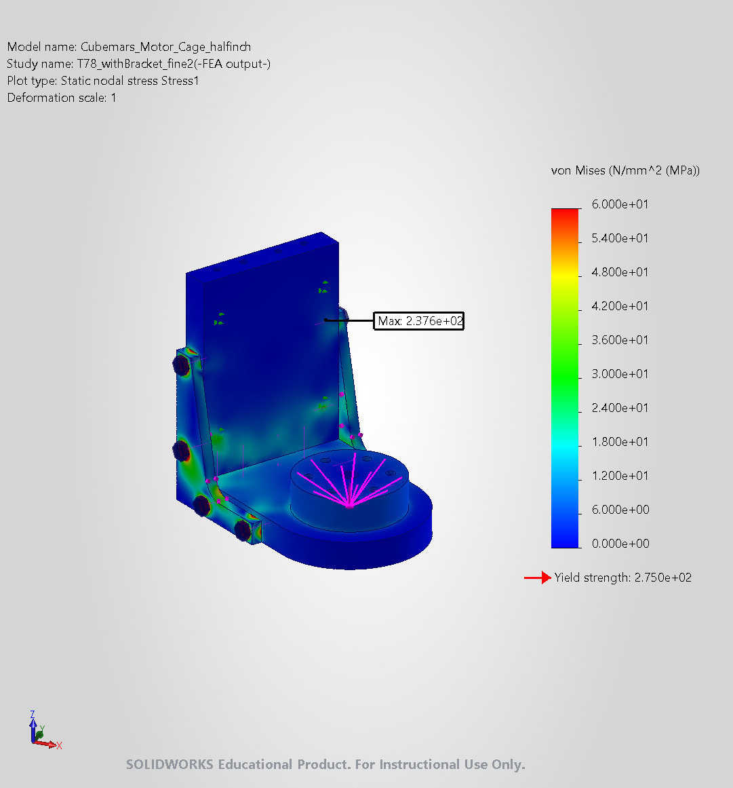
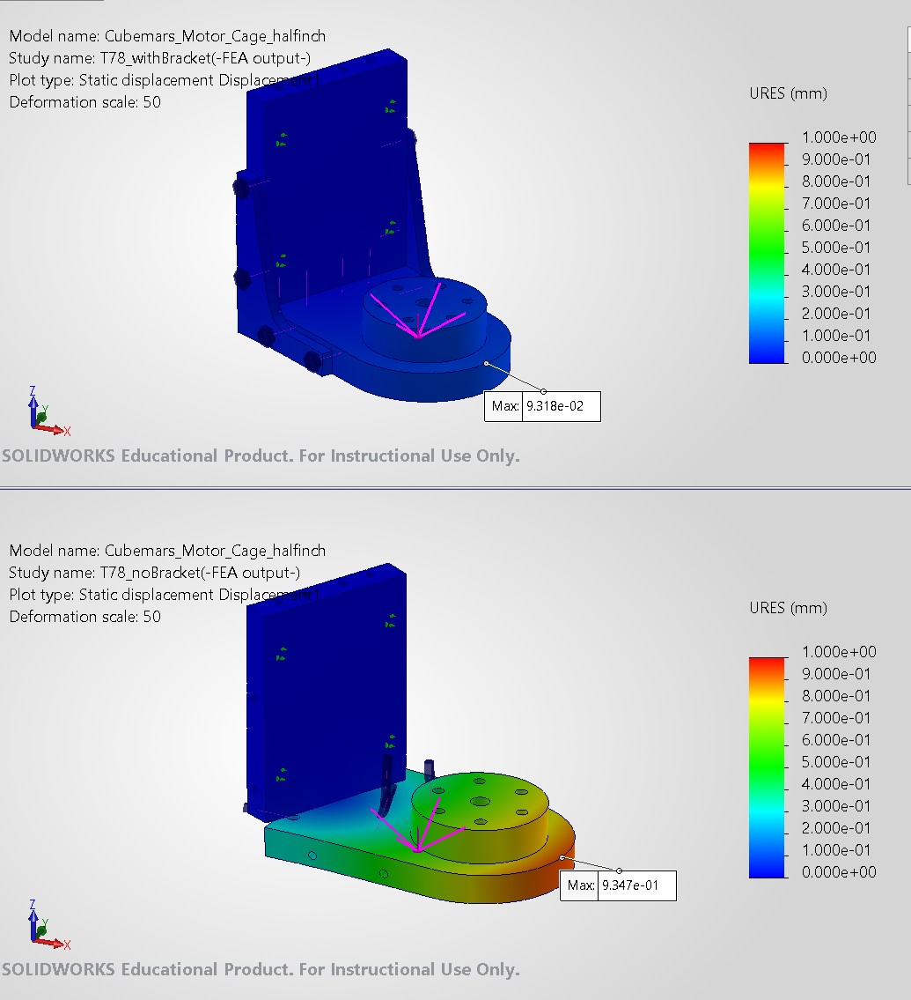
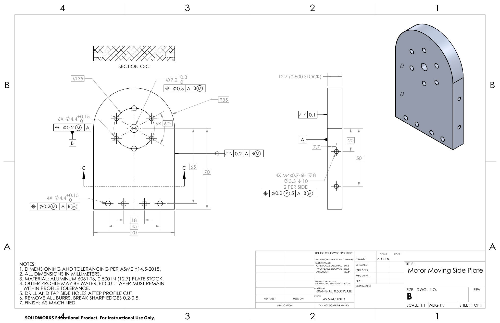

# Exoskeleton Motor-Cage Output Joint: FEA and GD&T

Structural validation and production tolerancing of the output joint of an upper-limb
exoskeleton shoulder actuator (CubeMars AKH70-16, 78 N·m peak). The work runs end to
end, from a hand calculation that flagged a failure mode, through FEA of the redesign,
to an ASME Y14.5 drawing with tolerances derived from the assembly.

**Author:** Tien-Hao (Austin) Chen, M.S. ECE, UC San Diego
**Tools:** SolidWorks Simulation 2026, SolidWorks Drawings, LaTeX

| Report | What it shows |
|---|---|
| [**FEA report (PDF)**](fea/Torsional_Analysis_Motor_Cage_Output_Joint.pdf) | Bolt-slip prediction and gusset-bracket validation with preloaded-bolt FEA |
| [**GD&T report (PDF)**](gdt/GDT_Motor_Moving_Side_Plate.pdf) | Datum scheme, fixed-fastener allocation, projected zones, stack-up |
| [**Drawing (PDF)**](gdt/Motor_Moving_Side_Plate_Drawing.pdf) | ASME Y14.5-2018 drawing of the Motor Moving Side Plate |

---

## 1. Problem

The actuator's rotor drives the next link through a 4×M4 bolted joint between two
12.7 mm (½ in) 6061-T6 plates. A bolt-group calculation showed that at peak torque the
outermost bolt needs **1494 N** of shear, but a preloaded M4 joint can transmit only
**593 N** by friction, so the joint would slip. Two 5 mm gusset brackets were added to
bridge the two plates.

## 2. FEA: does the bracket fix it?

SolidWorks Simulation static study with 12 preloaded bolt connectors, frictional contact
(μ = 0.15), a rigid remote torque load and a three-level mesh-convergence study
(250k → 529k → 847k elements).

| Result | Value |
|---|---|
| Shear on the original 4×M4 bolts | reduced **32×**, all joints below slip |
| Torsional stiffness of the output joint | increased **8.9×** |
| Peak converged bracket stress (R10 fillet) | **55 MPa**, static safety factor 5.0 |
| Peak converged assembly stress | 208 MPa, preload bearing at a bolt-hole edge (washers recommended) |

<p align="center">
  
  
</p>
<p align="center"><sub>Left: von Mises stress with brackets (fine mesh). Right: displacement with vs. without brackets.</sub></p>

Singularities at contact edges and connector points were identified and excluded;
reported stresses are taken from regions whose values converged across all three meshes.

## 3. GD&T: making the redesign buildable

The Motor Moving Side Plate was dimensioned to ASME Y14.5-2018 with every tolerance
traced to how the part assembles:

- **Datums from function.** A = the face that seats on the rotor spacer (flatness 0.1);
  B = the 6×Ø4.4 bolt pattern that locates the plate on the rotor, referenced at MMC so
  inspection allows the same shift the screws do.
- **Fixed-fastener allocation.** Position tolerances come from T₁ + T₂ = H − F
  (Ø0.4 budget split Ø0.2 / Ø0.2 for the M4 clearance patterns).
- **Projected tolerance zone.** The bracket threads carry Ⓟ5: without it, a thread axis
  inside a Ø0.2 zone can drift 0.225 mm from true position at the top of the bracket.
- **All-around profile** of 0.2 on the waterjet-cut outline instead of ± dimensions.

**Findings**

- The already-machined Ø4.3 bracket holes leave the bracket only Ø0.1 of position
  tolerance. Opening them to Ø4.5 raises the budget to Ø0.5.
- Bracket coplanarity stack-up: **±0.50 mm worst case / ±0.26 mm RSS**. Aligning the
  plates with a straightedge before torquing removes the largest term (±0.30 / ±0.17 mm).

<p align="center">
  
</p>

---

## Repository layout

```
fea/
  Torsional_Analysis_Motor_Cage_Output_Joint.pdf
  report/              LaTeX source (pdfLaTeX): main.tex, figures/, data/
gdt/
  GDT_Motor_Moving_Side_Plate.pdf
  Motor_Moving_Side_Plate_Drawing.pdf
  report/              LaTeX source (pdfLaTeX): main.tex, figures/
docs/                  images used in this README
```

Each `report/` folder compiles as-is with `latexmk -pdf main.tex`, or can be uploaded to
Overleaf as a zip.

CAD models are not included. This work is part of a team exoskeleton project at the
Video Processing Lab, UC San Diego.
